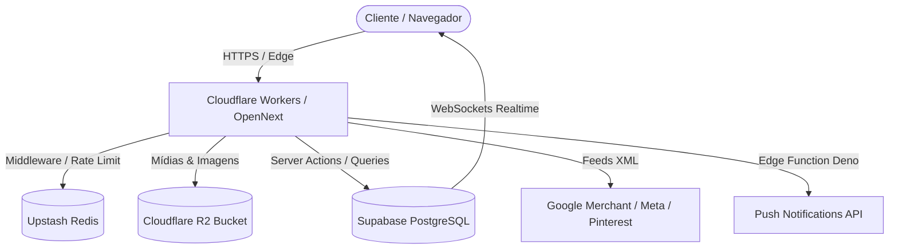

# 📘 Enciclopédia & Manual de Engenharia — Gringa Style

> **Documentação Técnica, Arquitetural, Banco de Dados e Regras de Negócio**  
> *Versão de Produção Consolidada — Outubro de 2026*  
> *Autor & Proprietário: Pepe2244*

---

## 📑 Índice Geral

1. [Visão Geral & Modelo de Negócio](#1-visão-geral--modelo-de-negócio)
2. [Arquitetura de Infraestrutura Serverless & Edge](#2-arquitetura-de-infraestrutura-serverless--edge)
3. [Dicionário de Dados & Esquema do Banco (PostgreSQL Supabase)](#3-dicionário-de-dados--esquema-do-banco-postgresql-supabase)
4. [Funções RPC & Stored Procedures Críticas](#4-funções-rpc--stored-procedures-críticas)
5. [Módulo E-commerce & Catálogo de Produtos](#5-módulo-e-commerce--catálogo-de-produtos)
6. [Módulo Checkout, Preços e Cupons (Motor Antifraude)](#6-módulo-checkout-preços-e-cupons-motor-antifraude)
7. [Módulo Rifas e Sorteios em Tempo Real (Loteria Federal)](#7-módulo-rifas-e-sorteios-em-tempo-real-loteria-federal)
8. [Módulo B2B & Serviços Industriais (Soldas Especiais)](#8-módulo-b2b--serviços-industriais-soldas-especiais)
9. [Módulo Tráfego, Feeds XML e Mecanismos de Busca](#9-módulo-tráfego-feeds-xml-e-mecanismos-de-busca)
10. [Módulo Telemetria, Analytics & Conformidade LGPD](#10-módulo-telemetria-analytics--conformidade-lgpd)
11. [Módulo PWA & Web Push Notifications](#11-módulo-pwa--web-push-notifications)
12. [Módulo Logística & Cálculo de Frete](#12-módulo-logística--cálculo-de-frete)
13. [Firewall de Borda, Rate Limiting & Segurança](#13-firewall-de-borda-rate-limiting--segurança)
14. [Painel Administrativo & Gestão de Mídias (R2)](#14-painel-administrativo--gestão-de-mídias-r2)
15. [Mapa Estrutural de Arquivos do Projeto](#15-mapa-estrutural-de-arquivos-do-projeto)
16. [Guia de Manutenção, Troubleshooting e Como Clonar o Projeto](#16-guia-de-manutenção-troubleshooting-e-como-clonar-o-projeto)

---

## 1. Visão Geral & Modelo de Negócio

O **Gringa Style** é um ecossistema comercial híbrido desenvolvido para o mercado de vestuário, soldagem, equipamentos industriais e engajamento comunitário:

1. **Loja Virtual E-commerce (B2C):** Catálogo de produtos com variações (voltagem, tamanho, cor), frete dinâmico via Correios, checkout assistido para WhatsApp com geração de código de rastreio de pedido e chave PIX Copia-e-Cola com desconto à vista.
2. **Serviços Industriais & B2B:** Área institucional com portfólio de engenharia de soldagem pesada (`/soldas-especiais` e `/gs-servicos-industriais`), com formulários dedicados para orçamentos de empresas.
3. **Plataforma de Rifas Gamificadas:** Sistema de arrecadação por cotas de bilhetes com sincronização ao vivo via WebSockets e apuração baseada na extração oficial da **Loteria Federal**.
4. **Motor de Aquisição de Tráfego:** Feeds XML automatizados e sanitizados para Google Shopping, Facebook/Instagram Catalog e Pinterest Ads, com submissão instantânea via IndexNow para o Bing.

---

## 2. Arquitetura de Infraestrutura Serverless & Edge

Toda a aplicação opera sob uma topologia moderna de **Custo Fixo Praticamente Zero** (Serverless Isolates), dispensando instâncias de servidores VPS (como EC2 ou Droplets):



### Componentes de Infraestrutura:
- **Cloudflare Workers (via OpenNext):** Hospeda e executa o Next.js 16 na borda global em V8 Isolates com latência inferior a 25ms no Brasil.
- **Supabase (PostgreSQL 15+):** Gerencia autenticação, dados relacionais, Row Level Security (RLS) e servidor de WebSockets Realtime.
- **Cloudflare R2 Storage:** Armazenamento de alta velocidade compatível com S3 para fotos de produtos, comprovantes e banners, sem tarifas de download (*Zero Egress Fees*).
- **Upstash Redis:** Banco de dados em memória na nuvem para firewall e limitação de requisições distribuído (*Rate Limiting*).

---

## 3. Dicionário de Dados & Esquema do Banco (PostgreSQL Supabase)

O banco de dados é governado pelo arquivo consolidado [`supabase/migrations/20261030000000_consolidated_schema_and_policies.sql`](file:///c:/Users/pedro/Desktop/gringa-style-loja-main/supabase/migrations/20261030000000_consolidated_schema_and_policies.sql).

### 3.1. Tabela `public.produtos`
Armazena o catálogo da loja.
- `id` (SERIAL / BIGINT, PK): Identificador numérico do produto.
- `nome` (TEXT, NOT NULL): Nome comercial.
- `slug` (TEXT, UNIQUE): Identificador amigável para SEO e URLs limpas.
- `descricao` (TEXT): Descrição detalhada com especificações técnicas.
- `preco` (DECIMAL(10,2), NOT NULL): Preço de tabela (cartão de crédito).
- `preco_pix` (DECIMAL(10,2)): Preço com desconto para pagamento à vista.
- `categoria_id` (INT, FK `categorias.id`): Categoria vinculada.
- `imagens` (TEXT[]): Array de URLs das fotos do produto (no Cloudflare R2).
- `em_estoque` (BOOLEAN, DEFAULT true): Visibilidade e disponibilidade para compra.
- `destaque` (BOOLEAN, DEFAULT false): Se deve aparecer na vitrine principal da Home.
- `tags` (TEXT[]): Tags para busca interna e taxonomia.
- `created_at` (TIMESTAMPTZ): Data de cadastro.

### 3.2. Tabela `public.categorias`
Organiza as seções da loja.
- `id` (SERIAL, PK): Identificador da categoria.
- `nome` (TEXT, NOT NULL): Ex: "Máscaras de Solda", "Acessórios", "Streetwear".
- `slug` (TEXT, UNIQUE): Slug para rota `/categoria/[id]`.
- `ordem` (INT, DEFAULT 0): Posição de ordenação nos menus.
- `ativa` (BOOLEAN, DEFAULT true): Ativação no catálogo.

### 3.3. Tabela `public.pedidos`
Armazena todos os checkouts iniciados na loja.
- `id` (UUID, PK, DEFAULT gen_random_uuid()): ID interno do pedido.
- `codigo_pedido` (TEXT, UNIQUE, NOT NULL): Código amigável (ex: `GS-A1B2C3`).
- `status` (TEXT, DEFAULT 'pendente'): `pendente`, `pago`, `enviado`, `cancelado`.
- `cliente_nome` (TEXT, NOT NULL): Nome do comprador.
- `cliente_telefone` (TEXT, NOT NULL): Telefone/WhatsApp do cliente.
- `cliente_email` (TEXT): E-mail do cliente (opcional).
- `endereco` (JSONB): Objeto estruturado com CEP, rua, número, bairro, cidade e UF.
- `total` (DECIMAL(10,2), NOT NULL): Valor total com frete e descontos aplicados.
- `subtotal` (DECIMAL(10,2), NOT NULL): Soma bruta dos produtos.
- `frete` (DECIMAL(10,2), DEFAULT 0.00): Valor cobrado pelo frete.
- `metodo_pagamento` (TEXT, NOT NULL): `pix` ou `cartao`.
- `cupom_codigo` (TEXT): Código do cupom utilizado (se houver).
- `desconto` (DECIMAL(10,2), DEFAULT 0.00): Valor monetário abatido.
- `itens` (JSONB, NOT NULL): Array snapshot dos produtos comprados no momento do pedido.
- `created_at` (TIMESTAMPTZ, DEFAULT now()): Data e hora do pedido.

### 3.4. Tabela `public.cupons`
Controla os cupons de desconto.
- `id` (SERIAL, PK): Identificador do cupom.
- `codigo` (TEXT, UNIQUE, NOT NULL): Código digitado pelo usuário (armazenado em maiúsculas).
- `tipo` (TEXT, NOT NULL): `percentual` (ex: 10%) ou `fixo` (ex: R$ 50,00).
- `valor` (DECIMAL(10,2), NOT NULL): Valor numérico da dedução.
- `valor_minimo` (DECIMAL(10,2), DEFAULT 0): Subtotal mínimo para ativação do cupom.
- `expira_em` (TIMESTAMPTZ): Data limite de validade.
- `limite_usos` (INT): Quantidade máxima total de usos permitidos.
- `usos_atuais` (INT, DEFAULT 0): Contador de quantas vezes já foi usado.
- `ativo` (BOOLEAN, DEFAULT true): Ativação manual pelo lojista.

### 3.5. Tabela `public.rifas`
Controla as campanhas de arrecadação e sorteios.
- `id` (SERIAL, PK): Identificador da rifa.
- `titulo` (TEXT, NOT NULL): Nome do prêmio/campanha.
- `descricao` (TEXT): Regras e detalhes do sorteio.
- `preco_cota` (DECIMAL(10,2), NOT NULL): Preço de cada número (ex: R$ 1,50).
- `total_cotas` (INT, NOT NULL): Total de cotas disponíveis (ex: 100, 1.000 ou 10.000).
- `data_sorteio` (TIMESTAMPTZ): Data prevista do sorteio pela Loteria Federal.
- `status` (TEXT, DEFAULT 'ativa'): `ativa`, `encerrada`, `cancelada`.
- `numero_vencedor` (INT): Número premiado principal (1º prêmio).
- `imagens` (TEXT[]): Fotos do prêmio principal.

### 3.6. Tabela `public.cotas`
Bilhetes individuais de cada rifa.
- `id` (BIGSERIAL, PK): Identificador da cota.
- `rifa_id` (INT, FK `rifas.id`): Rifa correspondente.
- `numero` (INT, NOT NULL): O número específico do bilhete (ex: 42, 007).
- `status` (TEXT, DEFAULT 'livre'): `livre`, `reservada`, `paga`.
- `comprador_nome` (TEXT): Nome de quem comprou.
- `comprador_telefone` (TEXT): Telefone de contato para localização.
- `comprador_cpf` (TEXT): CPF opcional para conferência.
- `reservado_em` (TIMESTAMPTZ): Data/hora da reserva (expira se não for pago em X min).
- `pago_em` (TIMESTAMPTZ): Data/hora da confirmação do pagamento.
- *Constraint de Unicidade:* `UNIQUE(rifa_id, numero)` impede cotas duplicadas.

### 3.7. Tabela `public.premios`
Prêmios vinculados à rifa (quando há múltiplos prêmios na Loteria Federal).
- `id` (SERIAL, PK): ID do prêmio.
- `rifa_id` (INT, FK `rifas.id`): Rifa correspondente.
- `ordem` (INT, NOT NULL): `1` (1º Prêmio), `2` (2º Prêmio), `3` (3º Prêmio)...
- `descricao` (TEXT, NOT NULL): Ex: "1º Prêmio: Inversora TIG 200A", "2º Prêmio: Máscara Automática".
- `vencedor_numero` (INT): Número contemplado.
- `vencedor_nome` (TEXT): Nome do contemplado.
- `vencedor_telefone` (TEXT): Telefone do contemplado.

### 3.8. Tabela `public.campanhas`
Banners informativos e faixas promocionais do topo da loja.
- `id` (SERIAL, PK): ID da campanha.
- `texto` (TEXT, NOT NULL): Mensagem exibida (ex: "Frete Grátis acima de R$ 299").
- `link` (TEXT): URL de destino ao clicar.
- `ativo` (BOOLEAN, DEFAULT true): Liga/Desliga.
- `cor_fundo` (TEXT): Cor hexadecimal de fundo.
- `cor_texto` (TEXT): Cor da fonte.

### 3.9. Tabela `public.push_subscriptions`
Armazena as inscrições do navegador para envio de Web Push.
- `id` (UUID, PK, DEFAULT gen_random_uuid()): ID da assinatura.
- `endpoint` (TEXT, UNIQUE, NOT NULL): URL de destino do serviço do navegador (Google/Mozilla/Apple).
- `p256dh` (TEXT, NOT NULL): Chave pública de criptografia do dispositivo.
- `auth` (TEXT, NOT NULL): Token de autenticação da inscrição.
- `user_agent` (TEXT): Navegador e dispositivo (Mobile/Desktop).
- `created_at` (TIMESTAMPTZ, DEFAULT now()): Data de autorização.

---

## 4. Funções RPC & Stored Procedures Críticas

Para evitar inconsistências financeiras e fraudes no front-end, operações sensíveis rodam como **Funções SQL no PostgreSQL com `SECURITY DEFINER`**:

### 4.1. `admin_draw_raffle_winner(p_rifa_id INT)`
- Realiza o sorteio aleatório eletrônico entre as cotas com status `pago`.
- Atualiza o `numero_vencedor` na tabela `rifas`, marca a rifa como `encerrada` e registra o ganhador no prêmio de ordem 1.

### 4.2. `admin_set_raffle_winner_by_number(p_rifa_id INT, p_numero INT, p_ordem INT)`
- Utilizada para cadastrar o resultado oficial extraído da **Loteria Federal**.
- Localiza quem comprou a cota `p_numero` na rifa `p_rifa_id`.
- Grava os dados do vencedor na tabela `public.premios` para a ordem informada (`p_ordem`).
- **Garantia de Integridade:** Se `p_ordem = 1`, atualiza também o campo mestre `numero_vencedor` na tabela `public.rifas`.

### 4.3. `increment_coupon_usage(p_codigo TEXT)`
- Incrementa atomicamente o contador de utilizações:
  ```sql
  UPDATE public.cupons 
  SET usos_atuais = usos_atuais + 1 
  WHERE UPPER(codigo) = UPPER(p_codigo) AND ativo = true;
  ```
- Garante que duas compras simultâneas não ultrapassem o limite configurado pelo lojista.

### 4.4. `comprar_cotas_rifa(p_rifa_id INT, p_numeros INT[], p_nome TEXT, p_tel TEXT)`
- Realiza uma trava de linha (`SELECT ... FOR UPDATE`) sobre os números solicitados.
- Se algum número já estiver com status `reservada` ou `paga`, cancela a transação e retorna erro imediatamente.
- Se todos estiverem livres, atualiza para `reservada` e vincula o nome e telefone do comprador.

---

## 5. Módulo E-commerce & Catálogo de Produtos

### 5.1. Normalização de Busca NFD
Localizado em [`lib/product-service.ts`](file:///c:/Users/pedro/Desktop/gringa-style-loja-main/lib/product-service.ts) e [`utils/slugify.ts`](file:///c:/Users/pedro/Desktop/gringa-style-loja-main/utils/slugify.ts):
- A função decompõe caracteres Unicode (Normalization Form D) e remove a faixa de diacríticos:
  ```typescript
  export function normalizeSearchText(text: string): string {
    return text.normalize('NFD').replace(/[\u0300-\u036f]/g, '').toLowerCase().trim();
  }
  ```
- Permite que buscas por `mascara tig`, `máscara tig` ou `MASCARA TIG` tragam exatamente os mesmos resultados.

### 5.2. Conversor Automático de Armazenamento Legado
Localizado em [`lib/site-config.ts`](file:///c:/Users/pedro/Desktop/gringa-style-loja-main/lib/site-config.ts):
- Se uma foto de produto no banco apontar para o antigo Supabase Storage desativado, o sistema sanitiza o caminho e aponta para o CDN do **Cloudflare R2** (`process.env.NEXT_PUBLIC_R2_PUBLIC_URL`), garantindo que nenhuma foto quebre na loja.

---

## 6. Módulo Checkout, Preços e Cupons (Motor Antifraude)

### 6.1. Validação Estrita de Preços no Servidor
Arquivo [`lib/checkout-pricing.ts`](file:///c:/Users/pedro/Desktop/gringa-style-loja-main/lib/checkout-pricing.ts):
- O front-end envia apenas `{ id, quantidade }`.
- O servidor busca os dados em tempo real no banco Supabase.
- **Preço PIX vs Cartão:** Se a forma for `pix`, aplica o `preco_pix`. Se for cartão, aplica o `preco`.
- Limite de quantidade: Máximo de 99 unidades por produto por pedido.

### 6.2. Persistência de Pedidos (`app/actions/checkout.ts`)
Antes de redirecionar o cliente para o WhatsApp, a ação `createOrderRecord`:
1. Gera o código único `#GS-XXXXXX` (baseado em timestamp e sufixo criptográfico aleatório).
2. Salva o registro completo na tabela `public.pedidos`.
3. Chama `incrementCouponUsage(couponCode)`.
4. Retorna o código do pedido para o cliente.

### 6.3. Redirecionamento Enriquecido para WhatsApp
No arquivo [`app/carrinho/page.tsx`](file:///c:/Users/pedro/Desktop/gringa-style-loja-main/app/carrinho/page.tsx), a mensagem é estruturada:
```text
🛍️ *NOVO PEDIDO: #GS-A1B2C3*
--------------------------------
👤 *Cliente:* Pedro Scarpim
📞 *Telefone:* (11) 99999-9999
📍 *Entrega:* Rua Exemplo, 123 - Centro - São Paulo/SP (CEP: 01001-000)

📦 *Itens:*
• 1x Cabo de Tocha TIG Alta Resistência - R$ 189,90
• 2x Luva de Raspa Soldador - R$ 79,80

💰 *Subtotal:* R$ 269,70
🏷️ *Cupom:* BEMVINDO10 (-R$ 26,97)
🚚 *Frete:* R$ 28,90 (Correios PAC)
💳 *Forma:* PIX com desconto à vista
🔥 *TOTAL:* R$ 271,63

🔑 *Chave PIX da Loja:* 38840525866
```

---

## 7. Módulo Rifas e Sorteios em Tempo Real (Loteria Federal)

### 7.1. Sincronização via WebSockets
- No arquivo [`app/rifa/page.tsx`](file:///c:/Users/pedro/Desktop/gringa-style-loja-main/app/rifa/page.tsx), o hook do Supabase subscreve ao canal:
  ```typescript
  supabase
    .channel('rifas-realtime')
    .on('postgres_changes', { event: '*', schema: 'public', table: 'rifas' }, payload => {
      // Atualiza o estado da grade de cotas ao vivo
    })
    .subscribe();
  ```
- O comprador vê em tempo real quando outros números são reservados ou confirmados.

### 7.2. Acompanhamento Público do Comprador
- Na rota [`/acompanhar-rifa`](file:///c:/Users/pedro/Desktop/gringa-style-loja-main/app/acompanhar-rifa/page.tsx), qualquer usuário insere seu telefone e visualiza:
  - Lista de números comprados.
  - Status do bilhete (Aguardando pagamento / Pago).
  - Comprovante digital e data prevista do sorteio.

---

## 8. Módulo B2B & Serviços Industriais (Soldas Especiais)

Além do e-commerce comum, a plataforma atua como geradora de leads B2B corporativos:

- **Rotas:** [`/soldas-especiais`](file:///c:/Users/pedro/Desktop/gringa-style-loja-main/app/soldas-especiais/page.tsx) e [`/gs-servicos-industriais`](file:///c:/Users/pedro/Desktop/gringa-style-loja-main/app/gs-servicos-industriais/page.tsx).
- **Formulário B2B:** [`components/GrupoHubContactForm.tsx`](file:///c:/Users/pedro/Desktop/gringa-style-loja-main/components/GrupoHubContactForm.tsx) coleta dados corporativos (Empresa, CNPJ, Tipo de Liga Metálica, Volume de Peças, Arquivos de Desenho Técnico).
- **Gestão de Portfólio B2B:** [`components/admin/B2BMediaManager.tsx`](file:///c:/Users/pedro/Desktop/gringa-style-loja-main/components/admin/B2BMediaManager.tsx) permite subir fotos de laudos, ensaios não destrutivos e soldagens técnicas no Cloudflare R2.

---

## 9. Módulo Tráfego, Feeds XML e Mecanismos de Busca

### 9.1. Feed do Google Merchant Center (`/api/google-feed`)
- Gera padrão XML RSS 2.0 com namespace `xmlns:g="http://base.google.com/ns/1.0"`.
- Utiliza a taxonomia oficial do Google em [`lib/taxonomy.ts`](file:///c:/Users/pedro/Desktop/gringa-style-loja-main/lib/taxonomy.ts) (ex: `Hardware > Welding & Soldering`).
- Mapeia tags essenciais: `g:id`, `g:title`, `g:description`, `g:link`, `g:image_link`, `g:availability`, `g:price`, `g:sale_price`, `g:condition` (new), `g:brand` e `g:shipping`.
- **Sanitização:** Rejeita arquivos de vídeo (`.mp4`, `.mov`) nas tags de imagem para não ser reprovado pelo Google.

### 9.2. Feeds Meta & Pinterest
- `/api/meta-feed`: Catálogo sincronizado com Meta Business Suite para anúncios de carrossel no Instagram e Facebook.
- `/api/pinterest-feed`: Catálogo estruturado para Pins de compra no Pinterest Ads.

### 9.3. Protocolo IndexNow (`/api/indexnow`)
- Implementado em [`lib/indexnow.ts`](file:///c:/Users/pedro/Desktop/gringa-style-loja-main/lib/indexnow.ts).
- Envia requisições HTTP POST para `https://api.indexnow.org/indexnow` com a chave do domínio, notificando Bing e Yandex instantaneamente sempre que uma URL é atualizada.

---

## 10. Módulo Telemetria, Analytics & Conformidade LGPD

### 10.1. Otimização de Performance (Core Web Vitals)
- Em [`components/AnalyticsLoader.tsx`](file:///c:/Users/pedro/Desktop/gringa-style-loja-main/components/AnalyticsLoader.tsx) e [`components/GoogleAnalyticsOptimized.tsx`](file:///c:/Users/pedro/Desktop/gringa-style-loja-main/components/GoogleAnalyticsOptimized.tsx):
  - Scripts pesados de rastreamento (Google Analytics GA4, Microsoft Clarity, Ahrefs Analytics) são **deferidos**.
  - Só são injetados no DOM após o primeiro evento de interação do usuário (scroll, toque ou clique de mouse), garantindo nota máxima de performance (LCP e TBT) no Google PageSpeed.

### 10.2. Rastreamento Ético de Sessões (`/api/analytics/session`)
- Grava visitantes únicos, tempo de sessão e tags UTM de campanhas pagas (`utm_source`, `utm_medium`, `utm_campaign`) sem armazenar dados pessoais ou violar a LGPD.

### 10.3. Páginas de Conformidade Legal
- `/privacidade`: Política de privacidade aderente à LGPD e às diretrizes do Google Merchant.
- `/devolucao-e-reembolso`: Regras de troca em até 7 dias pelo Código de Defesa do Consumidor (CDC).
- `/sobre`: Dados institucionais, história e CNPJ da loja.

---

## 11. Módulo PWA & Web Push Notifications

A plataforma funciona como um Progressive Web App (PWA) instalável:
- **Service Worker (`public/sw.js`):** Gerencia cache offline de imagens e estilos, e intercepta eventos de notificação.
- **Inscrição de Usuários:** O componente [`components/PushNotificationButton.tsx`](file:///c:/Users/pedro/Desktop/gringa-style-loja-main/components/PushNotificationButton.tsx) solicita permissão do navegador e envia o token para `/api/push/subscribe`.
- **Disparo de Push em Massa:** A função Deno do Supabase em [`supabase/functions/send-push/index.ts`](file:///c:/Users/pedro/Desktop/gringa-style-loja-main/supabase/functions/send-push/index.ts) dispara notificações push com título, imagem e link direto para a promoção via protocolo Web Push (VAPID).

---

## 12. Módulo Logística & Cálculo de Frete

No arquivo [`app/api/shipping/route.ts`](file:///c:/Users/pedro/Desktop/gringa-style-loja-main/app/api/shipping/route.ts):
- Recebe o CEP de destino e o peso acumulado dos itens do carrinho.
- Consulta a API de cálculo dos Correios (PAC e Sedex).
- **Cache de CEPs:** Salva consultas recentes em memória para evitar chamadas de rede repetidas quando o usuário digita o mesmo CEP várias vezes.
- **Mecanismo de Fallback de Segurança:** Se os Correios ficarem fora do ar ou o CEP demorar a responder, o sistema calcula uma estimativa fixa segura (ex: R$ 28,90 para PAC), impedindo que o cliente abandone a compra por erro no cálculo de frete.
- **Frete Grátis:** Aplica automaticamente frete zero caso o subtotal atinja o valor definido na campanha ativa.

---

## 13. Firewall de Borda, Rate Limiting & Segurança

Configurado em [`middleware.ts`](file:///c:/Users/pedro/Desktop/gringa-style-loja-main/middleware.ts):

### 13.1. Filtro de Bots Abusivos
Bloqueia scrapers e crawlers que consomem banda sem gerar tráfego qualificado:
`DotBot`, `MJ12bot`, `Cyberscan`, `DataForSeoBot`, `Omgilibot`, `Barkrowler`, `MegaIndex`, `SeekportBot`, `Serpstatbot`, `Bytespider`, `TurnitinBot`, `Scrapy`.
*Motores legítimos (Googlebot, Bingbot, Applebot, GPTBot, ClaudeBot) têm passagem livre.*

### 13.2. Bloqueio de Arquivos Críticos
Requisições que procuram vulnerabilidades comuns são sumariamente bloqueadas com HTTP 403:
`.env`, `.git`, `wp-admin`, `wp-login.php`, `config.json`, `phpinfo.php`, `xmlrpc.php`.

### 13.3. Rate Limiting por Rota (Upstash Redis)
- `/api/admin/login`: 5 requisições por 15 minutos (anti-brute force).
- `/api/pagamento`: 10 requisições por hora por IP.
- `/api/validate-coupon`: 20 requisições por hora por IP.
- `/api/upload`: 20 requisições por hora por IP.
- `default`: 1.000 requisições por hora por IP.

---

## 14. Painel Administrativo & Gestão de Mídias (R2)

Acessível na rota `/admin`:
- **Autenticação:** Baseada em cookies criptografados `HttpOnly`, `SameSite=Strict`, `Secure` gerenciados por [`app/actions/auth.ts`](file:///c:/Users/pedro/Desktop/gringa-style-loja-main/app/actions/auth.ts).
- **Gestão de Produtos:** Interface gráfica para inclusão de itens, definição de preço cartão vs preço PIX, categorização e controle de estoque.
- **Upload Direto para Cloudflare R2:** No arquivo [`lib/r2.ts`](file:///c:/Users/pedro/Desktop/gringa-style-loja-main/lib/r2.ts), as imagens enviadas no admin são transmitidas diretamente para o bucket via `@aws-sdk/client-s3`, recebendo URLs públicas ultra rápidas na CDN do Cloudflare.
- **Gestor de Campanhas:** Permite alterar o aviso promocional da Home em tempo real, disparando `revalidatePath('/')` para atualizar o cache estático imediatamente para todos os visitantes.

---

## 15. Mapa Estrutural de Arquivos do Projeto

```text
gringa-style-loja/
├── app/
│   ├── actions/
│   │   ├── admin-data.ts           # Consultas e estatísticas para o painel admin
│   │   ├── auth.ts                 # Login/Logout de admin com cookies seguros
│   │   ├── checkout.ts             # Criação formal de pedidos e dedução de cupom
│   │   ├── produtos.ts             # CRUD de produtos com revalidação de tags
│   │   └── rifa.ts                 # Ações de reserva atômica e sorteio de rifas
│   ├── api/
│   │   ├── analytics/session/      # Rastreamento de sessões e UTMs
│   │   ├── calculate-total/        # Cálculo seguro de subtotal no backend
│   │   ├── google-feed/            # XML feed oficial Google Merchant
│   │   ├── indexnow/               # Webhook IndexNow para Bing/Yandex
│   │   ├── meta-feed/              # XML catalog para Meta Ads (Instagram/FB)
│   │   ├── pinterest-feed/         # XML feed para anúncios no Pinterest
│   │   ├── push/subscribe/         # Inscrição de tokens Web Push
│   │   ├── rifas/history/          # Histórico de rifas finalizadas
│   │   ├── rifas/tracking/         # Consulta de bilhetes por telefone
│   │   ├── rifas/winner/           # Informações públicas dos ganhadores
│   │   ├── shipping/               # Cálculo de frete Correios com cache
│   │   └── validate-coupon/        # Validação de cupom no carrinho
│   ├── acompanhar-rifa/page.tsx    # Interface de busca pública de bilhetes
│   ├── admin/page.tsx              # Painel administrativo completo
│   ├── busca/page.tsx              # Página de resultados de busca com filtros
│   ├── carrinho/page.tsx           # Sacola, frete, cupom e envio para WhatsApp
│   ├── categoria/[id]/page.tsx     # Listagem de produtos por categoria
│   ├── devolucao-e-reembolso/      # Termos de devolução (CDC / Google Merchant)
│   ├── favoritos/page.tsx          # Lista de desejos salva localmente
│   ├── gs-servicos-industriais/    # Página institucional B2B industrial
│   ├── historico/page.tsx          # Histórico de pedidos anteriores do cliente
│   ├── loja/page.tsx               # Catálogo completo da loja
│   ├── pagamento/page.tsx          # Tela de PIX Copia e Cola com 1 clique
│   ├── privacidade/page.tsx        # Política de privacidade LGPD
│   ├── produto/[id]/page.tsx       # Detalhes, galeria e variações do produto
│   ├── rifa/page.tsx               # Seletor interativo de rifas com WebSockets
│   ├── robots.ts                   # Diretrizes para indexadores de busca
│   ├── sitemap.ts                  # Mapa do site dinâmico com timestamps lastmod
│   ├── sobre/page.tsx              # Página sobre a marca e empresa
│   └── soldas-especiais/page.tsx   # Serviços especializados de solda B2B
├── components/
│   ├── admin/
│   │   ├── B2BMediaManager.tsx     # Upload de fotos e laudos industriais
│   │   ├── CampaignManager.tsx     # Banners e avisos promocionais
│   │   └── ProductManager.tsx      # CRUD visual de produtos e estoque
│   ├── home/
│   │   ├── CartRecoveryBanner.tsx  # Banner de recuperação de carrinho abandonado
│   │   ├── CategoryPageContent.tsx # Renderização do catálogo de categorias
│   │   ├── HomeContent.tsx         # Vitrine principal, destaques e carrosséis
│   │   ├── ProductFilters.tsx      # Filtros por preço, categoria e ordem
│   │   └── ProductGrid.tsx         # Grade responsiva de exibição de produtos
│   ├── modals/
│   │   └── DirectPurchaseModal.tsx # Modal de compra rápida em 1 clique
│   ├── SEO/
│   │   └── StructuredData.tsx      # Gerador de Schema.org JSON-LD
│   ├── AdvancedAnalytics.tsx       # Captura de eventos e conversões
│   ├── AnalyticsLoader.tsx         # Lazy loading de scripts de terceiros
│   ├── Breadcrumbs.tsx             # Navegação estruturada em migalhas de pão
│   ├── Footer.tsx                  # Rodapé completo com dados fiscais e links
│   ├── GoogleAnalyticsOptimized.tsx# GA4 otimizado para não travar a thread
│   ├── GrupoHubContactForm.tsx     # Formulário de contato para engenharia B2B
│   ├── Header.tsx                  # Cabeçalho com busca e gaveta móvel
│   ├── ProductCard.tsx             # Card de produto com badge de PIX
│   └── PushNotificationButton.tsx  # Botão de ativação de notificações push
├── lib/
│   ├── cache.ts                    # Revalidação de cache estático e tags
│   ├── checkout-pricing.ts         # Cálculo financeiro blindado no servidor
│   ├── indexnow.ts                 # Utilitário de disparo para IndexNow
│   ├── product-service.ts          # Camada de consultas de produtos e busca NFD
│   ├── r2.ts                       # Conexão S3 com Cloudflare R2
│   ├── site-config.ts              # URLs mestras e sanitização de storage
│   ├── supabase.ts                 # Inicialização do client Supabase
│   └── taxonomy.ts                 # Mapeamento taxonômico do Google Shopping
├── public/
│   ├── _headers                    # Cabeçalhos de cache HTTP e segurança Edge
│   ├── sw.js                       # Service Worker PWA e Push Notifications
│   └── imagens/                    # Logotipos e ícones estáticos otimizados
├── scripts/
│   ├── build.cjs                   # Script de orquestração do OpenNext Cloudflare
│   └── optimize-assets.mjs         # Otimização e compressão de imagens para WebP
├── supabase/
│   ├── functions/send-push/        # Edge Function Deno para envio de Web Push
│   └── migrations/                 # Migração mestre consolidada do PostgreSQL
├── tests/
│   └── search-and-slugs.test.mts   # Suíte de 16 testes automatizados nativos
├── middleware.ts                   # Firewall Edge e Rate Limiter Upstash
├── next.config.ts                  # Otimizações de build do Next.js
└── package.json                    # Dependências e scripts do ecossistema
```

---

## 16. Guia de Manutenção, Troubleshooting e Como Clonar o Projeto

### 16.1. Variáveis de Ambiente Essenciais (`.env.local` / Cloudflare Secrets)
```ini
# Supabase
NEXT_PUBLIC_SUPABASE_URL="https://seu-projeto.supabase.co"
NEXT_PUBLIC_SUPABASE_ANON_KEY="eyJhbGciOi..."
SUPABASE_SERVICE_ROLE_KEY="eyJhbGciOi..."

# Configurações da Loja
NEXT_PUBLIC_SITE_URL="https://gringastylebr.com.br"
NEXT_PUBLIC_PIX_KEY="38840525866"
NEXT_PUBLIC_WHATSAPP_PHONE="5511999999999"

# Cloudflare R2 (Storage de Fotos)
R2_ACCOUNT_ID="seu-account-id"
R2_ACCESS_KEY_ID="sua-access-key"
R2_SECRET_ACCESS_KEY="sua-secret-key"
R2_BUCKET_NAME="gringa-imagens"
NEXT_PUBLIC_R2_PUBLIC_URL="https://pub-xxxxxx.r2.dev"

# Upstash Redis (Edge Rate Limiting)
UPSTASH_REDIS_REST_URL="https://sua-url.upstash.io"
UPSTASH_REDIS_REST_TOKEN="seu-token"

# Web Push (VAPID)
NEXT_PUBLIC_VAPID_PUBLIC_KEY="BEl62iUYg..."
VAPID_PRIVATE_KEY="sua-chave-privada"
```

### 16.2. Comandos Operacionais Diários
- `npm run dev`: Inicia o servidor local de desenvolvimento.
- `npm test`: Executa os 16 testes automatizados de regras de negócio.
- `npm run typecheck`: Executa a checagem rigorosa de tipos TypeScript sem emitir arquivos.
- `npm run lint`: Valida as regras de estilo de código com o ESLint.
- `npm run build`: Compila o Next.js e gera o worker do OpenNext para Cloudflare.
- `npm run deploy`: Realiza o build e publica a versão ativa no Cloudflare Workers.

### 16.3. Troubleshooting & Resolução de Problemas Frequentes
1. **As fotos dos produtos não carregam:**
   - Verifique se a variável `NEXT_PUBLIC_R2_PUBLIC_URL` está configurada corretamente e se o bucket no Cloudflare R2 está com a opção "Public Access" (acesso público) ativada.
2. **O build falha com erro de dependências no CI (`npm ci`):**
   - Execute `npm install` localmente para sincronizar o `package.json` com o `package-lock.json`, faça commit de ambos e envie para o GitHub.
3. **Erro no Feed do Google Shopping durante o build estático:**
   - Os feeds são dinâmicos com cabeçalho `Cache-Control: s-maxage=3600`. Em tempo de build, chaves dummy podem gerar alertas no log, mas em tempo de execução no Cloudflare Worker as credenciais reais do Supabase assumem a consulta.
4. **Dois clientes reclamam do mesmo número de rifa:**
   - O sistema usa a transação `comprar_cotas_rifa`. O banco nunca deixará dois pagamentos para a mesma cota serem confirmados; a interface pública em `/acompanhar-rifa` serve como prova auditável de quem concluiu primeiro.

### 16.4. Como Clonar Esta Plataforma para um Novo Negócio em 1 Hora
1. Faça um Fork ou clone deste repositório para uma nova pasta.
2. No Supabase, crie um novo projeto e rode a migração única [`20261030000000_consolidated_schema_and_policies.sql`](file:///c:/Users/pedro/Desktop/gringa-style-loja-main/supabase/migrations/20261030000000_consolidated_schema_and_policies.sql) no SQL Editor.
3. Crie um novo bucket no Cloudflare R2 e preencha as variáveis no `.env.local`.
4. Altere as variáveis `NEXT_PUBLIC_SITE_URL`, `NEXT_PUBLIC_PIX_KEY` e `NEXT_PUBLIC_WHATSAPP_PHONE`.
5. Substitua as imagens da pasta `/public/imagens/` (logotipo e favicon) e ajuste as cores em `app/globals.css`.
6. Rode `npm run deploy`. O novo e-commerce + sistema de rifas estará no ar em produção.
